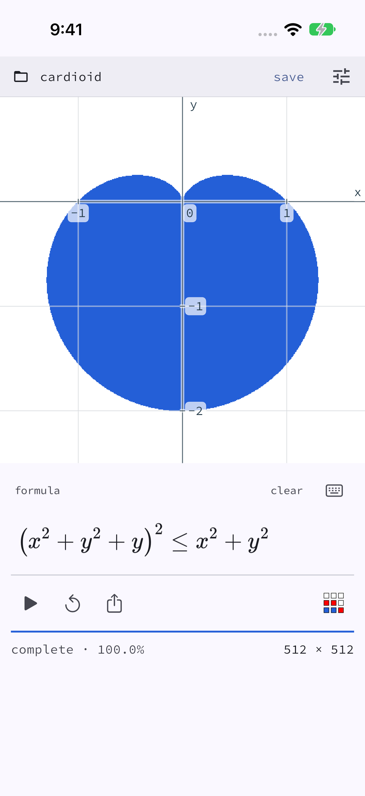
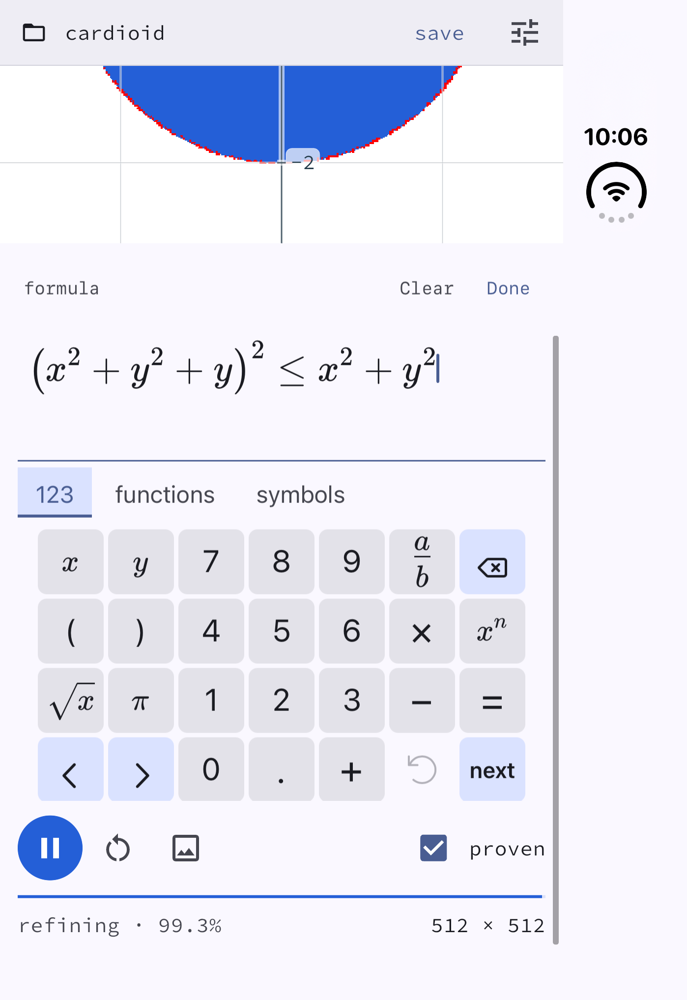
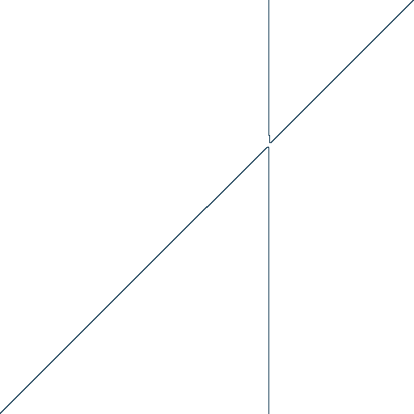
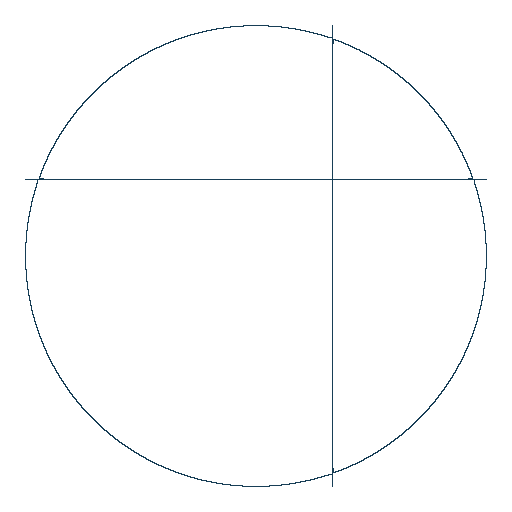
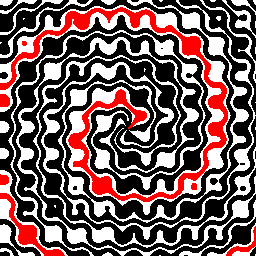

# relgraph

explore equations and inequalities as pictures. relgraph uses interval arithmetic to draw curves and fill regions reliably, revealing fine structure as the view refines in front of you.

## why reliable graphing matters

sample-based graphing evaluates a relation at selected points, but
a graph can hide a lot between two sample points. so it's possible to
miss a narrow branch or connect points across a discontinuity. relgraph reasons
about whole regions: it proves where a relation is present or absent, then
subdivides the regions it cannot yet decide.

these examples show features that ordinary point-sampling approaches can miss.

| graph | what to look for |
| --- | --- |
|  | **near-cancelled pole** · `y = (x² − 3x)/(x − 3.001)`  almost a straight line—until the tiny difference between `3` and `3.001` sends two branches off the screen. a fixed set of x samples can step over the feature. |
|  | **circle with poles** · `f(x)² + f(y)² = 81`, where `f(t) = (t² − 3t)/(t − 3.001)`  the same narrow feature appears in an implicit relation: the circle-like outline is only part of the graph. the long, thin branches belong too. |

interval arithmetic is part of the method, alongside domain checks and
mathematical proofs. difficult regions may keep refining; unresolved pixels
remain visible instead of being silently treated as empty.

## a gallery of relations

spirals, textures and organic shapes emerge from surprisingly compact rules.
each image below comes directly from the relation or relations beside it.

| graph | relation and idea |
| --- | --- |
|  | **ember coil**  black: `mod(√(x²+y²) − 7/2 atan2(y,x) + sin(x) + cos(y), π) < π/2` red: `mod(√(x²+y²) − 7/2 atan2(y,x) + sin(x) + cos(y), 7π) < π/2`  radius and angle wind into a spiral; sine and cosine ripple its edges. |
|  | **continuous web**  `sin(x) + cos(y) + sin(x cos(y) + y sin(x)) > 0`  nested waves interfere to form an interlocking, almost living pattern. |
|  | **scattered cutouts**  `sin(min(x*sin(y),y*sin(x))) > cos(max(x*cos(y),y*cos(x)))+(2*(x-y)^2+(x+y-6)^2)/40-1/30*(12-x-y)`  sine, cosine, minimum and maximum create a face-like pattern inside a shaped envelope. |

## inspiration and foundations

relgraph is built on Jeff Tupper's research into reliable graphing:

- [Graphing Equations with Generalized Interval Arithmetic](https://www.dgp.toronto.edu/~mooncake/msc.html) · MSc thesis, 1996
- [Reliable Two-Dimensional Graphing Methods for Mathematical Formulae with Two Free Variables](https://www.dgp.toronto.edu/papers/jtupper_SIGGRAPH2001.pdf) · SIGGRAPH, 2001

Tupper's own program, GrafEq, has been doing this since the 1990s. many of relgraph's gallery relations come from GrafEq's gallery and bundled examples; credit for those examples goes to GrafEq. its website is still up:

`http://www.peda.com/grafeq/`

(http only, so your browser may grumble.)

relgraph is an independent implementation of these ideas for modern platforms, written with help from coding agents like Codex and Dot. relgraph is not affiliated with or endorsed by Tupper or GrafEq. any errors in relgraph are our own.

## numeric library

this repository contains relgraph's numeric core: four C modules for binary64
interval operations. the app, parser and complete graph renderer live in a
separate repository.

see [building](docs/building.md), the [numeric contract](docs/numeric-contract.md)
and [dependency notices](notices/README.md).

## license

relgraph's original code and documentation are
licensed under the [GNU Affero General Public License, version 3 only](LICENSE)
(`AGPL-3.0-only`). third-party dependencies retain their own licenses; see
[notices](notices/README.md).

[GMP and MPFR relinking materials for relgraph iOS 1.0 (733)](https://github.com/funge/relgraph/releases/download/ios-1.0-733-relink-kit/relgraph-ios-1.0-733-relink-kit.tar.xz).

The rights holder for the relgraph core separately permits the core to be included and distributed through TestFlight and the App Store as part of the official relgraph iPhone app, without requiring the rest of the app to be licensed under AGPL. This permission applies only to the official relgraph iPhone app. The public repository remains licensed under AGPL-3.0-only, and third-party licenses are unchanged.

separate commercial licensing for relgraph's original code is available on request.

## related research

[GIA — generalized interval arithmetic](https://github.com/funge/gia) is the
independent lean research project proving properties of generalized interval
arithmetic. relgraph is an initial application and proof target; building or
using relgraph does not depend on GIA.
